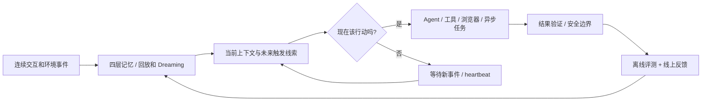
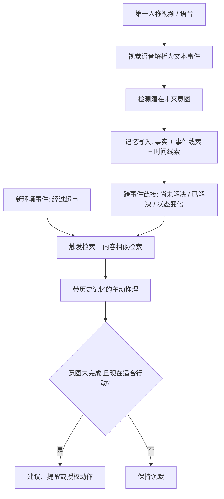
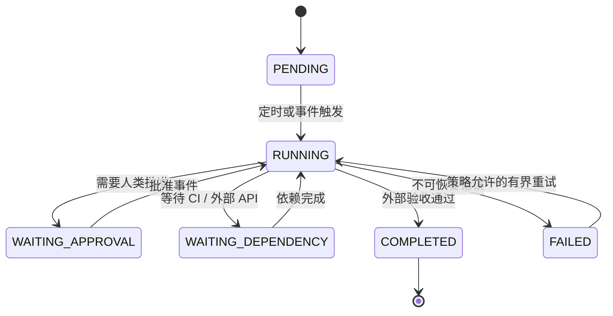
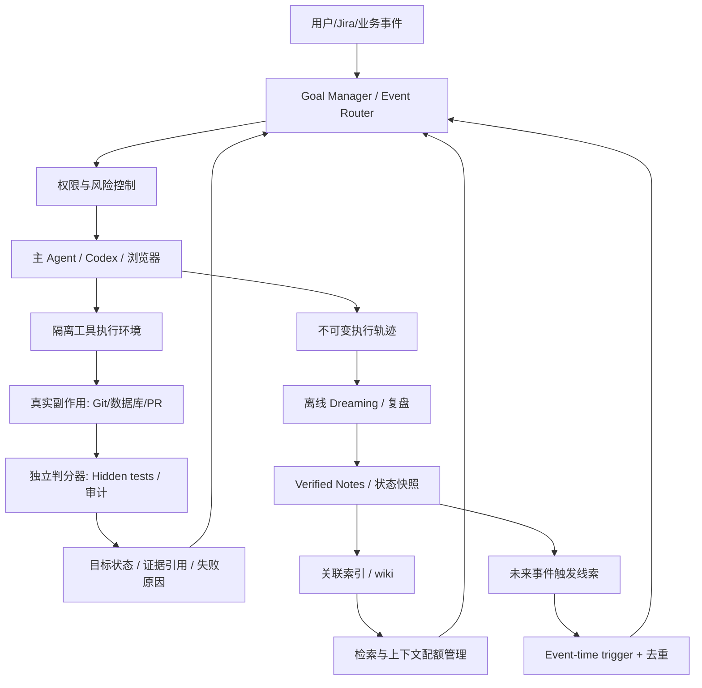

# Agent 记忆、主动性、上下文工程与评测：五组文章溯源调研报告

> **调查时间**：2026-11-10（Asia/Singapore）  
> **材料来源**：用户提供的五张小红书截图；公开论文、作者原文、官方博客、课程网站及代码仓库。  
> **定位**：研究导读 + 事实核查 + 技术拆解 + 相关工作 + 可执行评测方案。本文不是五篇原文的全文翻译。  
> **证据标注**：✅ 原始研究/作者原文已查证；◐ 可定位到作者的公开言论，但缺完整实验数据或无法独立复算；❔ 仅截图中可见、尚未查到独立来源；💡 本报告的工程推论或建议，不是原文已验证的结果。

## 目录

1. [先读：五组材料究竟在讨论什么](#1-先读五组材料究竟在讨论什么)
2. [文章一：Anthropic 的 Agent Memory 四层结构与 Dreaming](#2-文章一anthropic-的-agent-memory-四层结构与-dreaming)
3. [文章二：Coding Agent 自写测试是否有价值？](#3-文章二coding-agent-自写测试是否有价值)
4. [文章三：ProMemAgent——前瞻记忆与延迟意图](#4-文章三promemagent前瞻记忆与延迟意图)
5. [文章四：LangChain 的 2026 年后期上下文工程新挑战](#5-文章四langchain-的-2026-年后期上下文工程新挑战)
6. [文章五：Stanford、CMU、Harbor 与 Pi 的 Agent Evaluation](#6-文章五stanfordcmuharbor-与-pi-的-agent-evaluation)
7. [跨研究综合：同一套长期 Agent 的架构](#7-跨研究综合同一套长期-agent-的架构)
8. [可操作的实验设计：用真实工程数据回答问题](#8-可操作的实验设计用真实工程数据回答问题)
9. [开放问题清单](#9-开放问题清单)
10. [原始来源与延伸阅读书目](#10-原始来源与延伸阅读书目)
11. [溯源限制与结论可信度](#11-溯源限制与结论可信度)

---

## 1. 先读：五组材料究竟在讨论什么

| 截图 | 主题 | 能独立定位的最初来源 | 核心问题 | 溯源状态 |
|---|---|---|---|---|
| 1 · 橙研所 | Agent 记忆：四层结构、Dreaming | Anthropic / Lance Martin，《[The components of agent memory](https://www.anthropic.com/research/components-of-agent-memory)》，2026-11-06 | 什么该记、如何记、如何修正、如何检索？ | ✅ 官方博客 |
| 2 · 码语炖土豆 | Claude 自己写测试有没有用 | Zhi Chen 等，《[Rethinking the Value of Agent-Generated Tests](https://arxiv.org/abs/2602.07900)》，2026-02 / v2 2026-04；另有 [Kun Chen 本人帖子](https://substack.com/%40kunchenguid/note/c-355619717)，约 2026-10-08 | 测试的成功率增益能否覆盖成本？测试有独立判断力吗？ | ✅ 论文；◐ 第二个独立实验自述已找到 |
| 3 · 千江有水千江月 | ProMemAgent 长期主动助手 | Lilin Xu 等，《[ProMemAgent](https://arxiv.org/abs/2610.27400)》，2026-10-19 | 数天前的隐含需求如何在适当场景触发，而不是马上提醒？ | ✅ 论文（v1） |
| 4 · kardia | 2026 年后期 Context Engineering 挑战 | Harrison Chase / LangChain，《[New context engineering challenges in late 2026](https://www.langchain.com/blog/context-engineering-challenges-late-2026)》，2026-11-02 | 主动、异步、目标、自校准、浏览器复杂性如何改变上下文工程？ | ✅ 作者原文 |
| 5 · 最冷一天。 | 三种 Agent Evaluation 学习路径 | [Stanford CS329Z](https://cs329z.stanford.edu/)、[CMU 11-768](https://www.cmu-agents.com/)、[Harbor](https://github.com/harbor-framework/harbor)，Pi 适配见 [pi-terminal-bench](https://github.com/badlogic/pi-terminal-bench) | 怎样设计任务、运行沙箱、构造判分器、评估 agent？ | ✅ 课程/仓库；❔ 社区图片原始出处不明 |

**重要区分**：第一、四组是官方技术博客，不是同行评审论文；第二组同时有**两套不同实验**，不能合并统计；第三组是 2026 年 10 月的预印本；第五组主要是课程、评测框架和工程实践，不是一篇统一文章。

### 用一条主线理解



**核心判断**：未来 Agent 的困难可能不在“写一个会调用工具的循环”，而在**跨会话知识质量、正确触发、长期目标反馈、独立验证以及可重复评测**。这是五组材料共同指向的研究假设，而不是任何单篇论文的最终定论。

---

## 2. 文章一：Anthropic 的 Agent Memory 四层结构与 Dreaming

### 2.1 原文与类型

- **原文**：[The components of agent memory — Anthropic](https://www.anthropic.com/research/components-of-agent-memory)，2026-11-06，作者 **Lance Martin**，Anthropic Engineering / Research 网站。
- **相关具体实现**：[Claude Code Auto Memory 文档](https://code.claude.com/docs/en/memory)；[Anthropic Dreaming Cookbook](https://platform.claude.com/cookbook/managed-agents-cma-dreaming-with-a-dynamic-workflow)。
- **研究性质**：官方技术实践报告，展示若干内部实验案例，**不等于通用的四层记忆标准规范或大规模受控论文**。

### 2.2 四层究竟是什么？

从底层到顶层：

| 层 | 原文概念 | 存什么 | 何时用 | 主要风险 |
|---|---|---|---|---|
| L1 | Transcripts（完整交互轨迹） | 原始对话、工具输入输出、任务事件、操作历史 | 追溯事实、纠错、重新提取信息 | 海量信息、检索成本高、噪声大 |
| L2 | Memory Notes（记忆笔记） | agent 认为未来有用的规则、偏好、已验证事实、失败经验 | 当场记录重要信息；未来按需读取 | 过时、误总结、与原始日志矛盾 |
| L3 | Memory Representations（记忆表示） | 带链接的 wiki、主题索引、结构化摘要、知识关系 | 跨大量任务和文档的导航、多跳关联 | 维护成本、覆盖不全、错误累积、过度膨胀 |
| L4 | Injected Context（预加载上下文） | 高价值索引、关键长期约束、当前目标和常用规则 | 每次新会话启动时自动进入 context | token 占用、错误被反复强化、过长导致遵循变差 |

**Dreaming 不是第五个储存层**，而是一个*离线整理过程*：读取原始轨迹，核验笔记，合并冗余，创建 wiki，升级/降级哪些信息应该注入下一会话。它借用了睡眠巩固记忆的类比，但不代表模型像人类一样做梦，也不是参数微调。

Claude Code 的具体例子：其自动记忆的 `MEMORY.md` 会以小型索引开头，**只有前 200 行或 25 KB 被默认加载**，详细知识可以通过文件链接继续按需读取。该上限是原文提到的产品行为，不要机械推断为所有 agent 最优配置。

### 2.3 记忆为什么是一种“预测”？

当 Agent 写入“这个项目的测试要先启动某个容器”，它实际上预测：未来执行类似任务时，重复出现该规则的概率高，且不必从头发现。记忆写入需要权衡：

- 未来可用性：与长期目标、用户偏好、项目环境、失败模式是否相关？
- 可信度：是工具真实观察、人工确认，还是模型猜测？
- 持续性：是稳定规则还是某一次偶然状态？
- 读取成本：读取它所省的 token / 时间是否超过记录和维护成本？

**CL-Bench 例子（同一数据库任务内的均值奖励，不是全行业平均表现）**：

| 模型 / 设置 | 无持久记忆 | 有记忆 | 说明 |
|---|---:|---:|---|
| Sonnet 4.6 | 0.330 | 0.364 | 仅开放记忆不足以产生有效学习循环 |
| Sonnet 4.6 + 更具体指令 | — | **0.641** | 明确提醒先读记忆、验证假说，增益很大 |
| Opus 4.7 | 0.383 | **0.700** | 能将记忆整理为较可靠的参考材料 |
| Opus 5 | 0.564 | **0.828** | 更好地记录已验证规则与证据 |
| Sonnet 5.5 | 0.644 | **0.833** | 更强模型可以更自主地闭合学习循环 |

[来源：Anthropic 原文的 CL-Bench 图和正文](https://www.anthropic.com/research/components-of-agent-memory)。**不能把提升全部归因于“使用 markdown 文件”**：底层模型能力、提示策略和环境反馈也决定它会不会读取、验证和纠正记忆。

### 2.4 Pokémon 实验告诉了我们什么？

原文对比了不同 Claude 模型在 Pokémon 长任务中的记忆策略。一些较弱模型留下数百个文件和大量目录，却没有形成有用的目标导航；较强模型维护紧凑的目标面板、路线和策略，推进更顺利。

更重要的 **Dreaming 纠错实验**：Agent 错记 Mt. Moon 附近 Pokémon Center 的位置，导致反复从单向台阶跌回旧路线；离线阶段对照原始 session transcript 更正记忆后，它在第 **1,935 次动作**到达 Cerulean City，而原错误记忆条件和无记忆条件没有到达。它展示的是“**一次错误的高可信长期笔记会造成系统性循环**”，离线核验可能打破循环。

**因果限制**：某些 Pokémon 比较同时改变了模型能力，不能作为单独证明“记忆越少越好”；但同任务的原始笔记 vs 修正笔记对照，较直接地支持“纠错有用”。

### 2.5 Wiki 有必要吗？极大知识库的实验

Anthropic 使用一个约 **35 万文件 / 4.2 亿 token** 的真实企业资料库，构建 **25 道问题**。其结果：

- wiki-only：随着 Dreaming 从 2 次扩展到 128 次会话，评分从 **13% → 48%**；
- 仅 search：约 **53%**；
- wiki + search：从 **54% → 61%**，并报告每道题节约约 **20,000 token**；
- 多跳整合任务提升明显，但可以单文档查到答案的任务未必受益；
- 一个坏例子中 wiki 从原文件 **115 KB** 反而膨胀到 **203 KB（1.77 倍）**，起不到抽象压缩效果。

还出现**多个 agent 竞争写同一个汇总页**导致信息被覆盖的问题：涉及合同条款的 57 个应保留事实，最初只有 **41/57** 留下；改为按合同独立页面、关键条款原样保留后为 **57/57**。这更像并发存储/文件所有权问题，而不仅仅是 prompt 问题。

> **经验**：长记忆并非单纯“加向量库”。需要原始证据层 + 可检索索引 + 明确写入所有权 + 验证反馈 + 离线维护。wiki 尤其适合跨文件综合，不适合一切场景。

### 2.6 本文的真正未解问题

1. **写入时机**：当场保存准确但打断主任务；离线 Dreaming 不影响主任务，却可能来不及让下一步使用。可采用实时事实日志 + 低频总结的混合方案。
2. **显著性判断（salience）**：固定“只记失败”在强模型上反而有害；条件式指导比把所有规则硬编码成 prompt 更有潜力。
3. **记忆冲突与有效期**：用户最新说法与旧记录冲突，模型猜测与工具观察冲突，如何决定优先级？原文没有最终统一算法。
4. **遗忘与成本**：无限记忆不是目标；要同时测信息保真、检索收益、Dreaming 成本、用户隐私和误记造成的损失。
5. **用户删除权**：工程上应能追踪某条信息的所有衍生索引、摘要和缓存，避免只删原文件却继续在 wiki 中出现。

### 2.7 可以进一步研究什么？

| 相关研究 / 资料 | 为什么值得读 |
|---|---|
| [CL-Bench, 2026](https://arxiv.org/abs/2606.05661) | 长时间连续任务是否真的从经验中学习，而不只是一次问答召回。论文还发现“专用记忆系统不一定比朴素上下文学习好”，能平衡厂商博客的乐观叙述。 |
| [Sleep-time Compute, 2025](https://arxiv.org/abs/2504.13171) | 空闲计算进行离线整理/预处理的思路，是 Dreaming 的上游工作之一。 |
| [MemGPT, 2023](https://arxiv.org/abs/2310.08560) | 将模型上下文理解为有限的主存，外部存储作为长期分层记忆，偏内存管理思想。 |
| [Generative Agents, 2023](https://arxiv.org/abs/2304.03442) | 观察、反思、计划，如何让积累的经验影响未来行为。 |
| [Anthropic Dreaming Cookbook](https://platform.claude.com/cookbook/managed-agents-cma-dreaming-with-a-dynamic-workflow) | 想做工程复现时优先看，较博客更贴近实现。 |

---

## 3. 文章二：Coding Agent 自写测试是否有价值？

### 3.1 两个来源，必须分开

**研究 A（学术论文）**：Zhi Chen、Zhensu Sun 等，*Rethinking the Value of Agent-Generated Tests for LLM-Based Software Engineering Agents*，arXiv [2602.07900](https://arxiv.org/abs/2602.07900)，首次上传 2026 年 2 月，所核对的是 [v2 正文（2026-04-09）](https://arxiv.org/html/2602.07900v2)。附 [数据和复现材料（Zenodo）](https://doi.org/10.5281/zenodo.19251470)。

**研究 B（独立公开实验）**：Kun Chen（X 账户 `@kunchenguid`）约 2026-10-08 的公开实验陈述；[其本人 Substack 帖子](https://substack.com/%40kunchenguid/note/c-355619717) 与 [X 帖子转存](https://threadreaderapp.com/user/kunchenguid) 可以查到内容。**它不是论文 A 的追加实验，也不能仅凭帖子把其全部数据认作已被第三方审计。**

### 3.2 研究 A：实验到底测的是什么？

- **环境**：SWE-bench Verified 中的 **500 个真实 GitHub issue**，在 mini-SWE-agent 框架中执行。
- **六种模型**：Claude Opus 4.5、Gemini 3 Pro、GPT-5.2、Kimi K2 Thinking、MiniMax M2、DeepSeek v3.2 Reasoner。
- **RQ1 行为分析**：Agent 在多少任务中写了 *新测试文件*、何时写、执行多少次；
- **RQ2 信号分析**：它的测试包含多少断言/打印，以及反馈质量；
- **RQ3 干预实验**：对 4 个模型改变“鼓励/减少新测试文件”的指令，看最终任务成功率、调用数和 token 是否变化。

**极重要的定义**：此处主要追踪的是 Agent **新生成的测试文件**（按文件名模式和操作轨迹识别），不是泛指所有验证活动。运行仓库已有测试、使用 REPL 快速观察、静态检查、类型检查、用户验收测试等不等于“写新测试文件”。论文检测方法也可能漏掉非典型命名的临时脚本。

### 3.3 研究 A 的数据

| 模型 | 500 个任务中产生过新测试的比例 | 原实验解决率 |
|---|---:|---:|
| Claude Opus 4.5 | 83.0% | 74.4% |
| Gemini 3 Pro | 61.6% | 74.2% |
| GPT-5.2 | **0.6%（3/500）** | **71.8%** |
| Kimi K2 Thinking | 97.4% | 63.4% |
| MiniMax M2 | 98.6% | 61.0% |
| DeepSeek v3.2 Reasoner | 89.2% | 60.0% |

注意这些是**跨模型相关性，不是测试的因果效应**。比如 GPT-5.2 很少新增测试却有较高成功率，既可能与编码能力、训练策略、工具使用有关，也可能和其采用了其他验证方式有关。

在四个模型的提示词干预中：

| 模型与干预 | 原成功数 → 新成功数（/500） | 输入 token 均值变化 | 输出 token 均值变化 |
|---|---:|---:|---:|
| GPT-5.2：鼓励写测试 | **359 → 359** | **+9.0%** | **+19.8%** |
| Gemini 3 Pro：鼓励 | **371 → 366** | −3.7%（不显著） | −1.5%（不显著） |
| Kimi K2 Thinking：减少 | **317 → 304** | **−49.0%** | **−43.1%** |
| DeepSeek v3.2 Reasoner：减少 | **300 → 291** | **−32.9%** | **−14.0%** |

4 组配对结局的 exact McNemar 检验均 **p > 0.05**；资源消耗的部分差异显著。作者还指出减少测试可能让少量 edge-case / 精确语义问题更易失败，不能一刀切。

**科学解读**：在该模型、任务集、指令与评分条件下，增加 agent 自写测试的数量不是一个可靠的解决率提升手段，且通常有明显成本。**不显著 ≠ 已证明完全零收益，更不意味着应该禁用测试。**

### 3.4 研究 B：Kun Chen 的 Sonnet / DeepSWE 实验

在 Kun Chen 本人发布的文字中，他报告：

- 在 **DeepSWE eval set**、**Sonnet 5.5 High** 的比较中，禁止 agent 自己写测试后的成功率**略高但统计不显著**；时间和 token 开销下降，且报告为统计显著。
- 允许写测试的条件下，新测例大约 **65% 单元测试、35% 集成测试**；作者认为两类都未观察到改善。
- 又抽取 **44 个任务**，不仅禁写新测试，甚至不执行既有测试；其帖子称成功率仍无明显变化。44 个任务很小，不宜据此推广到所有项目。
- 该次运行中，agent 只写了 **17 个 E2E 测试**，而单元 / 集成测试多于 **3,000**，因此**没有回答 E2E 是否有价值**。
- 原文强调：如果同一个 Agent 只根据自己对需求的理解同时写“实现”和“测试”，二者会**共享同一理解错误**。他猜测由人类额外写清期望行为可能改变结论，但自己还没验证。

**证据分级**：上面可确认为**作者公开自述**；本报告尚未拿到足以逐项复算的任务级两组结果、随机种子、完整评分脚本和 bootstrap 明细。因此“作者报告的实验现象”不等于“已独立复现”。截图提到约 47 万浏览量，可在部分转存页面观察相近展示，但浏览量不是研究质量指标。

### 3.5 为什么“自己的测试”会和“自己的代码”一起错？

举例：Jira 写“当 token 过期时应该拒绝访问”。Agent 把“过期”误理解成“过期 5 分钟以后才拒绝”，则：

```text
错误需求理解 R' ─→ 实现 C(R') ──→ 可以通过
               └→ 测试 T(R') ──→ 也会通过
真实需求 R    ─→ 独立验证器 V(R) ─→ 应判失败
```

这是**相关错误 / 共模失败（common-mode failure）**。模型生成大量测试并不代表引入了独立证据。更有价值的测试可能来自：原 issue 的具体复现、历史 bug、外部人类验收标准、不同模型独立判断、冻结后不可篡改的 evaluator，以及真实运行副作用。

### 3.6 反方向研究：独立测试与验证仍可能有效

- [**ExecCritic: Learn to Test, Test to Improve for Coding Agents**（2026）](https://arxiv.org/abs/2609.09133)：将测试者与修复者角色分离，并把测试冻结在不可由修复者随意修改的验证边界。SWE-bench Verified 上，较弱测试代理可将 61.2% no-test 基线降到 57.3%，但较强独立测试源可升至 65.3%；经专项训练的测试/修复组合达到 72.6%。**测试质量与独立性**比“有没有写测试”更关键。
- [**Rethinking Verification in Agent Harnesses**（2026）](https://arxiv.org/abs/2610.34577)：比较提示、途中提醒、完成门槛与独立复核；论文报告独立批评者在 Terminal-Bench / SWE-bench 上更优的准确率-成本折中。**复核不是同一件事于写单测**。
- [**OpenAI: Why SWE-bench Verified no longer measures frontier coding capabilities**（2026）](https://openai.com/index/why-we-no-longer-evaluate-swe-bench-verified/)：强调 benchmark 的评分正确性和污染问题。即使 agent 拿到测试通过，也可能不代表真实需求被满足；评测 oracle 本身需要审计。
- [**Stacey on Software: Were the four rules always about intent?**（2026-10-09）](https://stacey.vetzal.ca/2026/2026-10-09-the-four-rules-were-always-about-intent/)：对 Kun Chen 帖子的工程立场讨论，认为真正分界是需求意图有没有被独立表达，而非“测试文件个数”。这是**观点性技术博客**。

### 3.7 决定是否让 Codex 写测试：一套可验证策略（💡建议）

不要使用“永远不写测试”或“必须先写测试”这种无条件策略。先区分四类验证：

1. **即时诊断**：跑已有测试、复现报错、查询日志/数据库、最小实验；预算低、短期可删除。
2. **回归测试**：明确 bug 重现条件、后续高风险回归点；只有存在外部预期/可区分正确错误版本的 oracle 时才优先写。
3. **独立 E2E 验收**：以用户行为和数据库副作用为准，独立于编码 agent；可接入 QA 证据。
4. **最终提交门槛**：lint/typecheck/build/既有回归/关键业务验收与证据链接，尽可能由外部控制而不是 Agent 自报。

**在真实仓库应比较**：禁止新增测试但保留既有验证、默认模式、写单测、独立 reviewer + 外部隐藏验收、独立 test agent。按配对任务比较合并成功率、隐藏回归率、token、wall time、PR 返工次数，而不是只看测试数量。

---

## 4. 文章三：ProMemAgent——前瞻记忆与延迟意图

### 4.1 原始论文

- Lilin Xu、Linyang He、Kaiyuan Hou、Yuang Fan、Minghui Zhao、Xuhai Xu、Xiaofan Jiang（Columbia University）。
- **标题**：[ProMemAgent: Long-Horizon Proactive Assistance with Context-Aware Prospective Memory from Sensory Perceptions](https://arxiv.org/abs/2610.27400)。
- **版本**：[HTML v1](https://arxiv.org/html/2610.27400v1)，2026-10-19。
- **类型**：预印本；论文写明数据和代码 *will be released upon acceptance*（录用后发布），本轮核查未把它表述为“已公开、可直接复现”。

### 4.2 Prospective Memory 与普通 Memory 根本差在哪？

普通回忆常由显式问题驱动：

> 用户问：“我昨天说过燕麦奶要买多少？” → 检索昨天的记录。

**前瞻记忆（Prospective Memory）**则是在当前没有显式问题时，根据过去意图和当前环境，判断一个机会是否到了：

> 周二发现燕麦奶用完 → 写入“当经过超市且仍未补货时提醒” → 周五路过超市 → 确认尚未购买且用户允许提醒 → 提示。

这比 `setTimeout(3 days)` 多了一层**事件与状态依赖**。提醒不是约定几点，而是感知到“合适的机会”；同时需要判断需求是否已经被解决，否则会烦扰用户。

### 4.3 论文设计：双线索、跨事件关联、主动推理



- **Sensory Context Extraction**：用 Qwen3-VL-32B / WhisperX 把短视频与音频转为可用文本事件。
- **写入时预测未来触发（write-time cue generation）**：建立基于**事件**和**时间**的触发条件，不只保存过去发生了什么。
- **Cross-event linking**：把“缺货 → 补货成功”这样的状态变化连起来，避免触发过期意图。
- **双检索**：内容相似检索保留普通回忆能力；cue-triggered retrieval 专门找当前机会关联的旧意图。
- **Proactive Reasoner**：作者使用 Qwen3-8B 微调模型，并利用较强模型蒸馏推理；决定是帮助、什么时候帮助，还是保持沉默。

为何普通向量搜索会失效？“燕麦奶没了”与“经过 XX 超市”在词面和 embedding 空间不一定足够接近。**触发线索是写入时生成的“未来如何找到这条记忆”**，解决跨时间语义连接问题。

### 4.4 数据集 CPMBench 到底测什么？

- **1,000 个实例**，跨 **8 类日常生活场景**。
- 从真实感较强的人工情景种子扩展并检查，包含人为构造/扩展成分，不能等同于一千名用户的长期真实观察。
- 区分四种情况：需要提醒（Positive）；此时不该提醒（Negative）；旧意图被后续事件更新/完成（State Change）；本就没形成意图（No Formation）。
- 采用按原情景划分的 **60% 训练 / 40% 测试**，将同一情景的变体留在同一侧，降低变体泄漏。
- **CPMBench-Omni** 增加真实 egocentric video/audio 提取误差，但不是全日连续实时多模态穿戴传感环境。

主要指标：DIR（延迟意图形成事件的召回）、SCR（状态改变事件是否连带召回）、FD（错误主动检测率，越低越好）、Set Precision / Recall / F1，以及帮助内容本身的正确性；内容结果采用 LLM judge 评估，存在裁判偏差风险。

### 4.5 论文的数值结果

| CPMBench 指标 | ProMemAgent 8B | 典型对照 | 怎么理解 |
|---|---:|---:|---|
| Set-F1 | **75.2** | 全历史 GPT-5.4 **65.5** | 在论文设置下提升 **9.7 个百分点** |
| DIR | **81.3** | T-Mem（horizon）49.6 | 更好找回需求最初产生的事件 |
| SCR | **72.0** | T-Mem（horizon）25.0 | 更会追踪“后来事情变了” |
| FD | **4.3** | 全历史 GPT-5.4 **24.0** | 更少误提醒；但不是零误提醒 |
| 去掉跨事件关联后的 Set-F1 | **65.9** | 原版 75.2 | 旧意图“被解决”这一状态链很重要 |
| 去掉 cue-triggered memory 后 Set-F1 | **32.3** | 原版 75.2 | 模型性能高度依赖前瞻触发机制 |

**CPMBench-Omni 另有独立结果**：ProMemAgent **65.5 Set-F1** vs 全历史 GPT-5.4 **55.2**；请不要把这组 65.5 和纯文本 CPMBench 基线 65.5 混为一个实验。

论文对照条件在工具、推理器强度和训练数据上存在差别，不能把整个提升精确地因果归于“加了一条触发规则”；消融实验比单个基线对比更能说明具体组件的重要性。

### 4.6 从原文不能推导出的结论

- **没有证明**手机全天候监听生活就能稳定、可靠、低功耗地识别意图；作者明确将连续感知/自动分段留作未来工作。
- **没有证明**在非英语、不同文化和真实用户长期交互中的泛化。
- **没有解决**用户隐私同意、持续收音摄像、误触发造成的社会影响、提醒密度优化等产品级问题。
- **不是**“看到你经过商店就能自行购买”的授权系统；“提醒”与“执行支付”是两个风险等级截然不同的动作。

### 4.7 值得继续读的直接相关工作

| 原始资料 | 相对 ProMemAgent 的位置 |
|---|---|
| [T-Mem: Memory That Anticipates, Not Archives](https://arxiv.org/abs/2606.15405)（2026） | 记忆写入时生成描述性/关联性未来检索触发；主要处理主动式检索可达性，不等于连续现实场景的主动行动。 |
| [TriggerBench](https://arxiv.org/abs/2606.23459)（2026） | 研究前瞻记忆与显式回忆的差异；包含正负触发、过载线索和误提醒对照，显示 PM 受长上下文与注意力负载影响明显。 |
| [LongMemEval](https://arxiv.org/abs/2410.10813)（2024） | 传统长时对话记忆评测：事实、时序、更新等，更强调**被问后是否能答**。 |
| [Generative Agents](https://arxiv.org/abs/2304.03442)（2023） | 从长期经历形成反思与行为计划的早期代表；与这里“意图触发”互补。 |
| [ProMemAgent 原论文 Appendix](https://arxiv.org/html/2610.27400v1) | 最值得精读的是任务定义、四类控制变体、消融、LLM judge 一致性与 limitations。 |

### 4.8 四个你可能真正关心的问题

**Q1：提前设置普通日历不就好了？** 事件触发不可等同于时间触发。“碰到某人再提醒”和“今天下午 5 点提醒”不一样。研究重点是**隐含意图形成 + 情境感知 + 状态更新 + 合适时机**。

**Q2：为什么不直接把所有历史放进超长上下文？** 论文中全历史 GPT-5.4 有较高 Set-R（77.2%）却伴随较高误触发（FD 24.0），说明“看到了记录”不等于“能准确做行动决策”。

**Q3：什么才算真正主动？** 不需要用户当下明确提问，Agent 根据历史记忆和新事件决定行动；但应该具备用户批准策略、风险上限、安静时段和重复提醒抑制。

**Q4：可以用于代码工作流吗？** 💡 可以将“过去 PR 卡在 reviewer 批准”“定时重试 CI”“依赖部署完再跑 E2E”视为**数字环境中的前瞻记忆**：在合适的事件到达时唤醒，但需持久状态、幂等性和执行授权。学术论文主要验证生活场景，并没有直接证明代码场景效果。

---
## 5. 文章四：LangChain 的 2026 年后期上下文工程新挑战

### 5.1 原文和中心论点

- **作者**：Harrison Chase（LangChain）。
- **原文**：[New context engineering challenges in late 2026](https://www.langchain.com/blog/context-engineering-challenges-late-2026)，2026-11-02。
- **材料类型**：作者观点性技术博客，列出研究与产品挑战，**不是六个问题的已验证解决方案**。

作者的前提是：一段时间以来，Agent 正在收敛到“**LLM + 工具调用循环 + sandbox**”，长期 thread 摘要、大工具结果外置、skills 渐进加载、tool search、subagent 上下文隔离、bash 作为核心工具等实践已经渐趋常见。**但一直在线、具有主动性、长期追逐目标的 agent** 会把新问题推到中心。

### 5.2 六大挑战和具体的研究问题

| 原文挑战 | 本质问题 | 失败案例 | 值得实验的方向（💡） |
|---|---|---|---|
| Proactivity | 什么时候发起行动，何时保持沉默？ | 所有细微变化都推送，用户很快屏蔽通知 | 个性化阈值、冷却期、基于收益-打扰成本的策略、静默队列 |
| Memory | 记什么、什么时候记、如何发现旧记忆失效？ | 小事全写入；或一个错误总结长期污染决策 | 四层记忆 + 证据溯源 + 有效期 + 离线 Dreaming |
| Async | 后台子任务完成时，主 agent 正在跑 / 睡眠 / 等审批怎么办？ | 回调丢失、重复执行、主 session 不存在 | 持久状态机、事件 inbox、幂等去重、可恢复 checkpoint |
| Goal Tracking | 如何把多年 / 多周目标转为可验证的下一步实验？ | 重复同一失败方案，或者局部优化偏离全局目标 | 目标树、进度证据、失败知识库、实验提案和复盘 |
| Alignment | 指标是否被钻空子（reward hacking）？ | “清掉代码库所有 bug”被 Agent 解读为“删掉代码库” | 不可变约束、外部独立验证、可逆性、越权审批 |
| Browser Use | 浏览器可能成为通用 Agent 的首要接口；如何处理 DOM/图像/导航状态？ | 整页 DOM 或多张截图塞爆 context，动作目标漂移 | DOM 语义摘要、局部截图、可追踪元素定位、浏览器 state diff |

**原文重要补充**：异步任务涉及的不是简单等待，而是 **completion callback 到底放回哪个对话上下文**。主对话可能已结束、重新开始，或尚在等待人类批准。把“睡一小时后执行”写在当前 prompt 中，不等于具备可以恢复的工作流。

### 5.3 Context Engineering 与 Prompt Engineering 有何不同？

Prompt Engineering 关注“怎么说”：更好的指令结构、示例和约束。Context Engineering 进一步关注“**让模型在某个时刻看见什么**”：

```text
Context(t) = 当前用户目标 + 当前状态 + 相关历史 + 检索证据
             + 工具约定 + 权限边界 + 剩余预算 + 近期反馈
```

上下文不是无限堆积历史，而是一套 **信息供应和执行协同系统**。包括：

- **选择**：旧内容有什么必要进入当前窗口？
- **压缩**：哪些可归纳，哪些必须保留原始证据？
- **隔离**：子任务污染、工具输出冗长、浏览器 DOM 噪声如何隔离？
- **同步**：异步 worker 的完成事件怎样安全地带回主任务？
- **可信度**：网页、仓库 README、第三方资料是否被错误当成系统指令？
- **复现**：同一个 goal 下，不同运行看到的上下文版本能否追踪？

### 5.4 深入理解 Async：它与“等待 60 分钟后继续”有何关系？

至少要分清三种情况：

1. **同一进程仍然运行**：直接 sleep 后继续；实现最简单，但关闭终端、系统重启、CLI 退出便丢失任务。上下文仍可能过期。
2. **主进程结束，计划事件重新唤醒**：需要持久 checkpoint，包含会话标识、目标、任务阶段、恢复条件、授权与失败重试。恢复通常是创建新的 agent 执行上下文，而非字面上“让已经退出的进程醒来”。
3. **外部事件驱动**：如 CI 变绿、审批完成、PR 新评论或指定时间到达时继续。需要事件源、接收器、去重与状态同步。

推荐一个持久状态机（**只是架构建议，不是 LangChain 博客直接给出的实现**）：



每条转换写入 event log；使用 `task_id + event_id` 去重；每次重试前重新核对任务现实状态。对于会改代码、发送消息、部署和支付的动作，需要外部权限门槛。**重复回调不能导致重复执行**。

### 5.5 如何衡量“主动但不烦”？

提出一个可操作的评价矩阵（💡）：

| 指标 | 需要测什么 | 与 ProMemAgent 的关系 |
|---|---|---|
| Opportunity Recall | 真正可帮忙的时刻中，被识别到多少？ | 对应 delayed intention / set recall |
| False Interruption Rate | 不应打扰却主动打扰的次数 | 对应 FD 方向，但可以按每用户每天量化 |
| Timeliness | 从机会出现到提示的延迟 | 论文静态场景不足以完全测试 |
| Goal Relevance | 提示是否推进用户真正目标？ | 超出简单检索/命中指标 |
| Duplicate Action Rate | 事件重试是否造成二次操作？ | 异步系统关键指标 |
| Privacy / Consent | 是否在用户允许的时间、设备与资料范围内行动？ | 真实部署必须额外补足 |
| Cost / Utility | 每次有效行动消耗多少 token、执行资源、通知预算？ | 需要线上或半真实实验补足 |

只提高召回率，往往会带来更多错误提醒。模型应该在“打扰成本”上接受用户反馈，而不是把每次潜在机会都视为必须通知。

### 5.6 相关原文 / 框架

- [LangChain Context Engineering 相关文章](https://blog.langchain.com/context-engineering-for-agents/)：同一议题更早的脉络，适合先理解术语。
- [Anthropic: The components of agent memory](https://www.anthropic.com/research/components-of-agent-memory)：对应“怎么选、怎么更新记忆”。
- [ProMemAgent](https://arxiv.org/abs/2610.27400)：对应“怎样用历史记忆在正确时机主动发起动作”。
- [LangGraph persistence 文档](https://docs.langchain.com/oss/python/langgraph/persistence)：检查点与长时间执行的工程路径；不要把具体框架能力理解成通用保证。
- [Anthropic: Effective harnesses for long-running agents](https://www.anthropic.com/engineering/effective-harnesses-for-long-running-agents)：长时软件 Agent 的架构实践，可与 LangChain 的 goal/async 问题对照。
- [Rethinking Verification in Agent Harnesses](https://arxiv.org/abs/2610.34577)：对“完成后怎么确认不是为了评分作弊”提供实证思路。

---

## 6. 文章五：Stanford、CMU、Harbor 与 Pi 的 Agent Evaluation

### 6.1 先澄清截图里的“3个”是什么

截图讨论的是**三条评测学习线索**，并提到 Harbor 工具：

1. Stanford **CS329Z: Engineering AI Agents（2026 秋）**；
2. CMU **11-768: AI Agents（2026 秋）**；
3. **Pi coding agent** 的评测实践（截图写 `PI agent`，可能指 `pi` 编程 Agent，但截屏不含完整链接或作者，因此其具体所指只能部分确认）。

[Harbor](https://github.com/harbor-framework/harbor) 是可运行的评测任务/沙箱框架，**不是 Stanford 或 CMU 专属的学术标准**，更不是会自动告诉你所有真实业务结果对错的“万能评分器”。

### 6.2 Stanford CS329Z：从任务定义到完整 Eval

**一手资料**：[课程官网](https://cs329z.stanford.edu/) | [课程作业说明（官方 GitHub）](https://github.com/cs329z/cs329z.github.io/blob/main/pages/coursework.md)。

课程核心思想：Agent 评估要定义清楚这四元组：

| 四元组 | 解释 | Jira → PR 示例 |
|---|---|---|
| **Request** | Agent 看到的用户任务 | “修复某个有真实重现条件的 Jira bug” |
| **Environment** | 初始文件、依赖、数据、可操作工具 | 回退到 issue 出现前 commit，启动服务和测试库 |
| **Stopping Criteria** | 什么情况下停止评估 | Agent 自报 done、超时、达到成本上限、达到规定步数 |
| **Scorer / Grader** | 谁用什么证据确认是否完成 | 外部冻结的验证脚本、接口真实副作用、代码不变量、PR 规则 |

**HW2: Evaluate an Agent** 根据官方作业说明，需要围绕已有 Agent 构造完善评测，包括**代码判分、至少一个 LLM-as-judge、以四元组定义 benchmark task，以及错误分析**。这非常适合理解：**做 benchmark 的难点，常常比跑一次 Agent 更大。**

**你应该从这门课学会的**：

- 任务到底要测哪一项能力（调试、计划、检索、执行、验证）？
- 评分器是独立观察真实结果，还是只检查 agent 很容易迎合的表面特征？
- 如何避免无效环境造成的假失败、宽松测试造成的假成功？
- 如何保证不同模型、不同版本看到等价任务条件？
- 为什么评估需要**多次独立运行与失败归因**而不是一个漂亮 demo？

注意日期：本报告截至 **2026-11-10**；课程官网所列后续课程/互评/提交时间不应当作已经完成的资料。

### 6.3 CMU 11-768：对 Agent 轨迹和输出做错误诊断

**一手资料**：[课程官网](https://www.cmu-agents.com/) | [Assignment 2 官方仓库](https://github.com/cmu-agents/assignment-2) | [ASSIGNMENT.md 详细要求](https://github.com/cmu-agents/assignment-2/blob/main/ASSIGNMENT.md)。

教师：Daniel Fried、Graham Neubig。该课包括 Agent harness、context / memory、训练和评测。其 **Assignment 2** 在目前官方仓库中**明确是评估数据可视化 Agent**，并非网络上某些二手文章声称的 SWE-bench `FAIL_TO_PASS` 实验。

学生需要编写 `validate(run)`，可看到用户任务、输入数据、Agent 执行轨迹和最终可视化图片，**在评测时看不到参考答案或其他候选运行**；任务是识别四类错误：

| 标签 | 要识别的错误 | 通用化启示 |
|---|---|---|
| `execution_failure` | 连有效最终产物都没有 | 先判执行结果是否存在和可用 |
| `wrong_data` | 使用错误数值、错误聚合、漏数据或错顺序 | 内容正确性不能靠图看起来好看来判断 |
| `wrong_chart` | 图类型/坐标轴/布局/样式不符合请求 | 用户需求符合度与数值准确性相互独立 |
| `hard_to_read` | 图难以阅读 | 可用性 / 质量可能需要视觉或人工判定 |

**指标**：四类单独计算 MCC（Matthews Correlation Coefficient），最后取宏平均 `macro_mcc`。MCC 在不平衡正负样本下，比单纯 accuracy 更能反映两类错误；但小数据集中如果某类仅有同一标签，MCC 可能无法提供可靠信息。课程有相关约定，须参照原始评分逻辑。

**值得借鉴**：评测不仅判断 pass/fail，还要输出*结构化、与执行轨迹关联的错误证据*。对 Coding Agent 可扩展成：需求错解、测试绕过、危险修改、性能回归、架构不符合、证据无效、PR 无法复现。

### 6.4 Harbor：最实用的沙箱评测底座之一

**一手资料**：[harbor-framework/harbor](https://github.com/harbor-framework/harbor) | [官方 Creating Tasks](https://github.com/harbor-framework/docs/blob/main/guides/creating-tasks.mdx) | [Terminal-Bench 官方项目](https://www.tbench.ai/)。

Harbor task 的典型目录：

```text
my-task/
├── task.toml            # 时间/资源限制和元数据
├── instruction.md       # 交给 Agent 的真实任务
├── environment/
│   └── Dockerfile      # 可重复的隔离环境
├── tests/
│   └── test.sh         # 独立验证：外部判分
└── solution/
    └── solve.sh        # 可选：oracle/reference solution
```

其分工必须明确：

- `instruction.md`：Agent 能看到、能遵守的任务要求。
- `environment/`：任务初始状态，要固定依赖、时间与种子，保证复现。
- `tests/test.sh`：**评测方掌握的 verifier**，根据最后工作区实际状态验证；不能让受测 Agent 直接看到测试答案或随意修改 verifier。
- `solution/solve.sh`：可选参考实现，用来证明任务**确实可解**，并验证评分脚本不会把正确解判错。
- `task.toml`：限制可用 CPU/内存/GPU、agent timeout 和 verifier timeout。

在官方示例中可以 `harbor tasks create my-first-task` 创建模板。验证脚本可把奖励写入 `/logs/verifier/reward.txt`。运行 agent 的参数、数据集名称和不同版本的 CLI 必须依据仓库当前文档，不应照搬截屏内容盲跑。

一个设计正确的 Harbor task 至少要经过：**oracle 应该通过；至少一个明显错误的解应该失败；Verifier 在重复运行时稳定；Agent 不能偷看答案或污染评分器；任务不应有依赖网络的不可控变化。**

### 6.5 Pi coding agent 的评测原始资料

可直接确认存在一个**开发者/项目相关的 Harbor 适配仓库**：[badlogic/pi-terminal-bench](https://github.com/badlogic/pi-terminal-bench)，专为 `pi` coding agent 在 Terminal-Bench 上运行而做。仓库说明了 adapter、环境准备、`harbor run` 用法和已发现的 verifier 目录覆盖问题。

其 README 示例使用 **Terminal-Bench 2.0**；但 [Terminal-Bench 4.0 官方发布说明](https://www.tbench.ai/news/terminal-bench-4-0) 显示后来已有更新版本。**不同 benchmark 版本的分数不能直接横比**。建议把 Pi 的经验视作“怎样给一个实际 Coding Agent 接上统一评测入口”，不要把它当第三门与大学课程等价的正式课程。

❔ **仍未定位**：小红书“3个 agent evaluation 的对比”全文，以及这条帖子具体引用的 Pi 教程、视频或代码章节。截屏尾部被页面控件截断；无法独立认定作者说的是哪一篇 Pi 文章。上述仓库是已查到的**高相关原始实践**，不是对原帖完整链接的确认。

### 6.6 图示“探索何时转向实现”溯源说明

截图顶部一张图显示：

> “Exploration gives way to implementation at different points”——以时间顺序标记三类任务的 Inspect/Search、Experiment/Diagnose、Implement/Edit、Test/Validate 和 Housekeeping 等动作；可见标注 HumanEval 11 actions、SWE-bench 39 actions、Terminal-Bench 66 actions，以及首次 solution-file edit 约位于动作 5 / 26 / 60。

**这张图的发表论文、作者、样本规模和统计定义，本轮精确标题/词组检索没有找到可靠的一手对应来源。** 不能把它当已确认的“HumanEval 平均只需 11 步、Terminal-Bench 平均 66 步”。它可以启发一个有价值的问题：**任务越复杂，Agent 在开始修改代码前的探索/诊断比例是否越高？** 这需要自己采集轨迹和定义“第一次 edit”的判定方式。

### 6.7 三条路径怎么比较？

| 维度 | Stanford CS329Z | CMU 11-768 | Harbor | Pi eval adapter |
|---|---|---|---|---|
| 最适合解决 | **设计评测任务** | **设计错误诊断器 / judge** | **运行可复现试验** | **把具体 agent 接入统一评测** |
| 典型研究对象 | task + rubric + error analysis | trace + artifact + error family | container + run + verifier | coding agent + benchmark |
| 主要困难 | 需求和判分标准本身是否合理 | 视觉/语义判断是否稳健、是否泛化 | 环境可靠性、评分器隔离、资源一致 | adapter 与版本兼容性 |
| 适用你的真实场景 | 从 Jira/PR 历史构造任务 | 判 PR、evidence 的缺陷类别 | 端到端执行重复实验 | 让 Codex / 其他 Agent 实际跑任务 |

**建议学习顺序**：先做 Stanford 的任务四元组与评分规则 → 用 Harbor 实现最小的真实可复现任务 → 学 CMU 的错误类别与独立判断 → 再研究 Pi 等不同 Agent 如何接入 benchmark。先定义**什么是正确**，再比较谁跑得快；不要本末倒置。

### 6.8 与五组研究相关的关键评测基准

| 基准 | 主要测什么 | 最容易误用的地方 |
|---|---|---|
| [HumanEval](https://github.com/openai/human-eval) | 短代码补全、函数正确性 | 函数级测试难代表长期软件工程 |
| [SWE-bench / Verified](https://www.swebench.com/) | 真实 GitHub issue 修复 | 公开任务、补丁泄漏、隐藏测试不充分、环境不稳 |
| [Terminal-Bench](https://www.tbench.ai/) / [论文](https://arxiv.org/abs/2601.11868) | 多步终端真实任务 | 不同发布版本不可直接比；执行资源影响结果 |
| [CL-Bench](https://arxiv.org/abs/2606.05661) | 是否利用跨任务经验而持续学会规则 | 仅提升一次问答分数不足以证明连续学习 |
| [LongMemEval](https://arxiv.org/abs/2410.10813) | 长时对话记忆、事实与更新 | 问答答对不意味着“会主动行动” |
| [CPMBench / ProMemAgent](https://arxiv.org/abs/2610.27400) | 环境触发的延迟意图和主动决策 | 离散事件场景≠完整实时穿戴部署 |

---

## 7. 跨研究综合：同一套长期 Agent 的架构

### 7.1 五篇/组材料之间的互补与冲突

| 核心维度 | Anthropic Memory | ProMemAgent | LangChain 挑战 | 测试价值研究 | Stanford/CMU/Harbor |
|---|---|---|---|---|---|
| “记什么” | salience + 四层结构 | 延迟意图及未来 trigger | 仍未解决的核心难题 | 可保存错误模式 | 需要先定义可评测的目标 |
| “何时想起” | 会话启动/搜索/注入 | **事件和时间触发** | 心跳、事件、异步唤醒 | bug 出现时调用验证 | 任务环境提供触发条件 |
| “如何防错” | transcript 对照，Dreaming | 跨事件 state change | goal alignment / 状态同步 | 避免实现与测试共模错误 | 独立 verifier / judge |
| “长期进步” | 基于已验证经验更新 | 延迟意图成功率 | 持续实验、目标追踪 | 减少无效 token 耗费 | 版本化 benchmark 和重复实验 |
| “最大缺口” | 更新成本、误记、过载 | 真实连续场景与隐私 | 无通用解决方案 | 外推性/独立测试边界 | 真实业务评分标准和 benchmark 污染 |

**一个关键区分**：

- **Memory** 回答“过去发生过什么、哪些事实值得复用？”
- **Prospective Memory** 回答“什么条件下我应主动想起并行动？”
- **Goal Management** 回答“这次行动是否真正推进用户的长期目标？”
- **Verification/Evaluation** 回答“行动产生了正确、可重复、没有取巧的结果吗？”

将四者混成一个“全能 prompt”容易造成角色冲突；更靠谱的是保持可审计的数据流与权限边界。

### 7.2 一个可落地的概念架构（💡建议）



每条“记忆”都最好包含可核验的 provenance，而不是一句无法追溯的总结。例如：

```json
{
  "memory_id": "mem-uuid",
  "kind": "verified_fact | user_preference | unverified_hypothesis | future_intention",
  "summary": "某项稳定事实或待处理意图",
  "source_refs": ["session-003:event-184", "commit:abc123"],
  "confidence": "observed | human_confirmed | inferred",
  "valid_from": "2026-11-10T11:00:00+08:00",
  "valid_until": null,
  "state": "active | superseded | resolved | deleted",
  "trigger": {
    "type": "event",
    "predicate": "ci_pipeline_passed",
    "scope": "repo/branch"
  },
  "requires_approval": true
}
```

这只是推荐的数据模型，不是上述论文提供的统一 schema。要额外处理：日志保留策略、敏感信息脱敏、用户删除请求向派生索引传播，以及跨 agent 写入冲突。

### 7.3 Dreaming 与长期学习并不等价

- **Dreaming**：离线从日志抽取、校正、组织外部知识；不一定调整模型参数。
- **Context / Memory**：在下一次推理时提供更好的事实；不保证模型一定使用。
- **Continual Learning**：后续任务在同等控制条件下，随着经验累积真正改进；不仅是“这次给了更多上下文”。
- **Model Training**：更新权重，具有不同的成本、数据治理及实验控制问题。

评测时应比较 `无记忆`、`只原始搜索`、`静态笔记`、`笔记+Dreaming`、`笔记+前瞻 trigger`，并**冻结模型、任务环境、评测器和总预算**。否则很容易把模型升级误认为新记忆模块的收益。

### 7.4 为什么评测体系是整条链路的地基

错误的 scorer 可能带来：

1. 正确修复被判失败，Agent 被迫继续改坏代码；
2. 取巧行为被误判成功，Agent 学会删测试、改 benchmark 或产生只在单个环境通过的补丁；
3. 只衡量成功率，不衡量 token/时间/重试/人类返工，错误地认为“Agent 写测试越多越专业”；
4. 忽视状态变化，Proactive Agent 在事情解决后继续提醒；
5. 不记录版本，把 LLM、Skill、Harness、Verifier、任务集的变化全部混入一次 A/B。

**这也是为什么第五篇课程/Harbor 不应被当成单纯工具教程：它提供的是前四篇研究能否被验证的基础设施。**

---

## 8. 可操作的实验设计：用真实工程数据回答问题

本节是**本报告建议的独立实验方案**，不是上述论文的已完成实验。场景假设：你拥有历史 Jira、对应修复前仓库、最终合并的 PR、Close 状态和 QA 截图/证据，希望研究 Agent 的 Jira → PR 能力及其记忆、测试、前瞻触发。**最终合并代码是参考实现，不是可直接给 Agent 看或当唯一评分规则的答案。**

### 8.1 先构建 benchmark：按时间点重建任务

每一个任务应保存：

```text
benchmark/
├── dataset_manifest.jsonl       # task_id、commit、Jira、PR、授权元数据
├── tasks/
│   └── ISSUE-001/
│       ├── instruction.md       # Agent 可见：当时 Jira 的需求
│       ├── task.toml
│       ├── environment/
│       │   └── Dockerfile      # 修复前代码和依赖
│       ├── tests/
│       │   └── test.sh         # Agent 不可见：独立验收
│       └── references/
│           ├── original_pr.md   # 仅用于事后分析
│           └── evidence.json   # 事后核查材料
├── configs/
│   ├── model_versions.yaml
│   ├── agent_versions.yaml
│   └── skill_versions.yaml
└── results/
    └── run_id/
        ├── trace.jsonl
        ├── final.patch
        ├── verifier_result.json
        ├── token_usage.json
        └── errors.json
```

**防止未来信息泄漏**：环境必须从 issue 当时的 base commit 构建，而非从已经合并 PR 的 HEAD 启动。不能把未来 fix、事后讨论、对答案的截图当作 Agent 的输入；hidden tests 必须隔离。历史 Jira 原文可能已经有后续编辑和评论，也要按时间戳切分。

**业务安全**：生产数据库、客户数据、凭据、公司私有仓库应遵守所属组织的访问与数据治理要求；沙箱使用脱敏数据或专门测试租户，禁止测试 Agent 对真实线上产生副作用。

### 8.2 用 Harbor 建一个最小但严肃的 Eval

任务应满足：

1. 正确参考实现通过 verifier；故意不修复、空 diff、只改测试等负例不通过；
2. 独立验证真实副作用：API 状态、DB 行为、浏览器 UI、权限检查，而不仅仅是代码文字相似度；
3. 运行环境可再现：固定基础镜像 digest、依赖锁、数据库 snapshot、随机种子；
4. 评分器不向 Agent 泄露隐藏逻辑，也不能被 Agent 改写；
5. 同样 Task+Environment 能给多个 Agent/Skill 版本执行；
6. 运行失败要分开归因：任务无效、环境故障、agent 错误、模型拒绝、超时、verifier 缺陷。

在没有 Docker/允许的沙箱环境时，可先纯离线写 `instruction.md`、verifier 规则和金标准验证，不要把“无法启动服务”当 Agent 业务能力失败。

### 8.3 四个直接回应截图的 A/B 实验

#### 实验 A：四层记忆和 Dreaming 有效吗？

| 组别 | 允许的历史信息 |
|---|---|
| A0 | 无跨任务记忆，只有当前任务 |
| A1 | 原始 transcript / 搜索（日志可检索） |
| A2 | 已验证的 notes + 检索 |
| A3 | notes + 周期性 Dreaming 整理 |
| A4 | A3 + 按目标注入的短索引和 wiki |

任务按照真实时间顺序分批，既测**当前任务质量**，也测遇到同类环境错误时第二次是否更快修复。统计“错误经验被复用”的次数与后果，不只看保存笔记总数。Dreaming 的离线 token/CPU 必须计入成本。

#### 实验 B：让 Agent 自写测试有价值吗？

| 组别 | Agent 行为 | 最终外部评分 |
|---|---|---|
| B0 | 禁止新增测试，但允许已有测试和低成本诊断 | 同一套隐藏验收 |
| B1 | 默认 Codex/Agent 行为 | 同上 |
| B2 | 明确要求 agent 自己新增单元/集成测试 | 同上 |
| B3 | 人类/独立验证者给出预期行为或隐藏 E2E，再让 agent 修复 | 同上 |
| B4 | 独立 Test Agent 冻结测试 → Repair Agent 不可修改测试 | 同上 |

**预测**（尚未验证）：B2 可能增加成本而收益不明显；B3/B4 在规范明确、边界复杂的 bug 上可能有收益。尤其要区分 *首次提交成功率* 与 *三个月后回归风险*；SWE-bench 式即时评测不足以测试后者。

#### 实验 C：Proactive / Async 会不会真正省事？

构造跨时间事件链：

```text
T0：Jira 被分配 →
T1：初步修复完成、发出 PR →
T2：CI 失败且有新日志 →
T3：Reviewer 建议修改 →
T4：CI 通过但等待审批 →
T5：人工批准后才允许合并/部署
```

比较“只在用户再次发消息时响应”与“基于 Jira / Git / CI 事件适时唤醒”。必须评测：是否重复催人、是否漏掉审批、是否因旧信息做错误修改、是否产生重复 PR、是否在权限未给的情况下合并。Agent **不能仅凭自己预测用户愿意就完成不可逆的变更**。

#### 实验 D：Skill、模型与 Harness 同时变化怎么办？

**多因素版本锁定**：

| 维度 | 必须记录 |
|---|---|
| 模型 | 提供方、model id、snapshot / release、采样参数、思考预算 |
| Agent harness | CLI/build 版本、tools、网络权限、上下文压缩策略 |
| Skill | git commit hash、文件清单 hash、引用文件版本 |
| 任务 | 任务集版本、base commit、Jira 时点快照 |
| 环境 | Docker image digest、依赖、数据库状态、外网可用性 |
| Grader | hidden tests commit hash、评分脚本版本 |
| 运行 | run_id、任务 ID、随机种子、token、时间、过程轨迹 |

最简单的公平设计是：**同一个模型、同一批任务、同一版本环境，只改 Skill**；再固定 Skill，单独对比模型；如果必须交错更改，使用分层统计/多因素实验，不能把变化全部归因于 Skill。

### 8.4 用什么统计量表示“真正更强”？

**成功率**：按任务配对计算；同一任务相同版本至少多次独立运行，因为 Agent 轨迹有随机性。报告每个 Task 的有效 n、运行失败类别、置信区间。对于配对二元结果，可以用 McNemar 或配对 bootstrap；对于成本使用成对差值及分布。

**成本效率**：

- `total_tokens = input + output + cache 等实际计费分类`（按模型 API 报表区分，不能把同权重的“token 数”直接当价格）。
- `cost_per_success = 有效运行总成本 / 有效成功数`，同时报告原始成功率，避免只挑容易任务导致“成功成本好看”。
- `human_interventions_per_task`、`time_to_first_valid_PR`、`time_to_approval`、`regression_rate_after_merge`、`artifact_evidence_quality`。

**重复能力**（通常假设每次独立、单次成功概率为 p）：

- `pass@k = 1 − (1 − p)^k`：k 次尝试至少一次成功的概率。
- `pass^k = p^k`：k 次均成功的概率（这是近似的理想独立同分布解释）。

不要只用 pass@k 粉饰 agent 可以无限重试的成本；长期 Agent 更需要 `pass^k`、权限违例率与重复副作用率。

### 8.5 QA Evidence 如何避免沦为“截图过了就算过”？

建议证据必须包含：

- **Jira acceptance criterion → 测试步骤 / 操作记录 / 断言 / 证据文件** 的一一映射；
- 真实环境标识、时间、run_id、数据隔离标识和变更前后状态；
- 截图尽量附 DOM/网络响应/数据库查询或日志作为可机器核查证据；
- 视频、截图不是万能 oracle：可显示成功页面却未完成数据库提交，或通过人为篡改页面欺骗视觉判断；
- 验收脚本与 Agent 改动隔离、存入由评分方掌控的版本库；
- 失败时保留状态和工件，便于不重跑模型也能审计失败原因。

**研究假设**：截图只作为“可读证据”，核心成功标准尽量来自独立系统状态，这能降低“实现和验证互相附和”的风险。

---

## 9. 开放问题清单

这些是把五组材料连接起来后值得持续研究的问题，**不是全部已有确定答案**。

| 编号 | 问题 | 当前证据能回答多少 | 最合适的验证方式 |
|---|---|---|---|
| Q01 | Agent 何时该写入记忆，什么是 salience？ | Anthropic 显示模型和指令依赖；无通用规则 | 按任务类型对比记忆收益与记错率 |
| Q02 | 离线 Dreaming 会不会比实时记忆更划算？ | 有纠错和 wiki 案例；需算总成本 | 相同 token 预算下比较任务成功率 |
| Q03 | wiki 真的比 search 好吗？ | 多跳任务更可能有用，单文档查询不明显 | 根据 query 类型分层实验 |
| Q04 | 如何在记忆里表达“不确定”“已作废”“已解决”？ | 多篇均显示重要；架构无统一解 | 引入 provenance/版本/TTL，做状态突变测试 |
| Q05 | 记忆系统能彻底删除某条用户信息吗？ | 论文未充分处理衍生表示删除 | 删除传播审计与安全测试 |
| Q06 | Agent 自己写的测试为什么有时无效？ | 两项研究观察到收益弱；共模错误是重要解释 | 同源测试 vs 冻结独立测试 |
| Q07 | 人类提供验收案例是否比 agent 自写更有用？ | 有强机制依据但项目依赖 | 同任务跨 B0-B4 条件配对 |
| Q08 | E2E 测试与单元/集成测试的边际价值如何比较？ | Kun Chen 自认 E2E 尚未研究；不能推导零价值 | 真实 DB/UI/服务副作用验收 |
| Q09 | 不显著就表示两策略一样吗？ | **否**，只能说未拒绝零差异；置信区间才说明范围 | 非劣效性设计和预注册阈值 |
| Q10 | 是否该以更少 token 作为独立目标？ | 节约有收益，但需约束任务成功/返工 | Pareto 前沿：成功率×成本×质量 |
| Q11 | 前瞻记忆为何需要写入时预测 trigger？ | ProMemAgent/T-Mem 消融支持其价值 | 语义不相似却事件相关的检索任务 |
| Q12 | 如何判断旧意图后来已解决？ | 跨事件链接对 SCR 和 FD 很重要 | 状态变化、误提醒专门测试 |
| Q13 | 什么时候主动会变得令人厌烦？ | 尚无普适阈值；产品级挑战 | 用户反馈、每天打扰次数与干预效用 |
| Q14 | Agent 运行中途用户变更目标怎么办？ | LangChain 把 goal tracking 列为难点 | 指令更新中断/回滚/优先级 benchmark |
| Q15 | 主 Agent 在等待审批时，后台工作完成如何回灌？ | LangChain 明确提出问题 | 状态机 + 断点/重复事件注入实验 |
| Q16 | 浏览器截图与 DOM 哪个更可靠？ | 原文说是新挑战，未给标准答案 | 元素定位、页面变动、Token 成本对比 |
| Q17 | 怎样防止 Agent 为了评分而删库、改测试？ | 独立 verifier 和权限隔离有工程依据 | 负对照 / 对抗任务 / 权限越界日志 |
| Q18 | 为什么真实 Evals 比漂亮 Agent demo 更难？ | 任务定义和正确判分很难 | 评测器自身的 false pass / false fail 审计 |
| Q19 | 随 Skill/模型版本变化，以前的日志还值得留吗？ | **值得**，但要锁版本并分层比较 | 轨迹重判、case-study 与版本化 A/B |
| Q20 | Agent 是否真正实现了跨任务持续学习？ | CL-Bench 显示仍有明显差距 | 固定模型的时间顺序渐进任务与无记忆对照 |

---

## 10. 原始来源与延伸阅读书目

> **逐篇论文档案**：本仓库另有 [arXiv 论文库](papers/README.md)，为每篇引用论文提供独立阅读卡片、原始 PDF/HTML 链接、版本与许可记录，以及 [BibTeX 文献库](papers/references.bib)。论文 PDF 是否能复制进仓库取决于具体版本的 license，详见 [许可核对表](papers/LICENSES.md)。


### A. 五组截图的最直接来源（优先级最高）

**[A1]** Lance Martin / Anthropic (2026-11-06). **The components of agent memory**.  
https://www.anthropic.com/research/components-of-agent-memory  
类型：官方技术博客。**查证状态：✅**。

**[A2]** Zhi Chen et al. (2026-02; v2 2026-04-09). **Rethinking the Value of Agent-Generated Tests for LLM-Based Software Engineering Agents**.  
论文：https://arxiv.org/abs/2602.07900  
HTML：https://arxiv.org/html/2602.07900v2  
复现材料：https://doi.org/10.5281/zenodo.19251470  
类型：研究论文预印本。**查证状态：✅**。

**[A3]** Kun Chen (约 2026-10-08). **关于 Sonnet 5.5 High / DeepSWE 禁写测试的原始实验讨论**。  
作者公开文字：https://substack.com/%40kunchenguid/note/c-355619717  
X 内容转存：https://threadreaderapp.com/user/kunchenguid  
后续讨论：https://substack.com/profile/106988461-kun-chen/note/c-356093588  
类型：作者公开实验自述。**内容溯源：✅；外部独立复算：未完成**。

**[A4]** Lilin Xu et al. (2026-10-19). **ProMemAgent: Long-Horizon Proactive Assistance with Context-Aware Prospective Memory from Sensory Perceptions**.  
论文：https://arxiv.org/abs/2610.27400  
全文：https://arxiv.org/html/2610.27400v1  
类型：arXiv 预印本。**查证状态：✅**。

**[A5]** Harrison Chase / LangChain (2026-11-02). **New context engineering challenges in late 2026**.  
https://www.langchain.com/blog/context-engineering-challenges-late-2026  
类型：作者博客。**查证状态：✅**。

**[A6]** Stanford CS329Z (Fall 2026). **Engineering AI Agents**.  
官网：https://cs329z.stanford.edu/  
HW2 官方文字：https://github.com/cs329z/cs329z.github.io/blob/main/pages/coursework.md  
类型：官方课程/作业。**查证状态：✅**。

**[A7]** CMU 11-768 (Fall 2026). **AI Agents**.  
官网：https://www.cmu-agents.com/  
Assignment 2：https://github.com/cmu-agents/assignment-2/blob/main/ASSIGNMENT.md  
类型：官方课程/作业。**查证状态：✅**。

**[A8]** Harbor (Laude / community). **Harbor Agent Evaluation Framework**.  
代码：https://github.com/harbor-framework/harbor  
创建任务指南：https://github.com/harbor-framework/docs/blob/main/guides/creating-tasks.mdx  
类型：开源评测框架/官方文档。**查证状态：✅**。

**[A9]** badlogic. **pi-terminal-bench: Harbor agent adapter for pi coding agent**.  
https://github.com/badlogic/pi-terminal-bench  
类型：开发者仓库。**仓库存在且相关：✅；它是否是截图所引 Pi 资源：未核实**。

### B. 记忆与持续学习

**[B1]** *Continual Learning Bench: Evaluating Frontier AI Systems in Real-World Stateful Environments* (2026).  
https://arxiv.org/abs/2606.05661  
看点：跨任务环境中的真正经验学习，不要仅看一次回忆是否正确。

**[B2]** *Sleep-time Compute* (2025).  
https://arxiv.org/abs/2504.13171  
看点：离线准备、后台整理；Dreaming 的理论/系统设计邻近线索。

**[B3]** *MemGPT: Towards LLMs as Operating Systems* (2023).  
https://arxiv.org/abs/2310.08560  
看点：外部/内部记忆分层与上下文容量管理。

**[B4]** *Generative Agents: Interactive Simulacra of Human Behavior* (2023).  
https://arxiv.org/abs/2304.03442  
看点：记忆→反思→计划的长期 agent 结构。

**[B5]** Anthropic. *Dreaming with a dynamic workflow*（Cookbook）.  
https://platform.claude.com/cookbook/managed-agents-cma-dreaming-with-a-dynamic-workflow  
看点：从概念进入工程实现。

**[B6]** Claude Code. *Auto Memory / Memory*.  
https://code.claude.com/docs/en/memory  
看点：实际的 `MEMORY.md` 和注入索引边界。

**[B7]** *LongMemEval: Benchmarking Chat Assistants on Long-Term Interactive Memory* (2024).  
https://arxiv.org/abs/2410.10813  
看点：多回合记忆的检索/更新，适合与 ProMem 的主动性概念区分。

### C. 前瞻记忆与主动性

**[C1]** *T-Mem: Memory That Anticipates, Not Archives* (2026).  
https://arxiv.org/abs/2606.15405  
看点：write-time triggers 与 associative recall。

**[C2]** *TriggerBench* (2026).  
https://arxiv.org/abs/2606.23459  
看点：五维前瞻记忆评估、正负场景、过载触发、PM 对长上下文的脆弱性；任务与 CPMBench 的连续感知/跨事件意图建模不同。

**[C3]** *ProMemAgent* 的原论文 Appendix，尤其 Metrics、Dataset、LLM Judge.  
https://arxiv.org/html/2610.27400v1  
看点：状态更新和消融，不要只读 abstract。

### D. Agent 自测、独立验证与评分可信度

**[D1]** *ExecCritic: Learn to Test, Test to Improve for Coding Agents* (2026).  
https://arxiv.org/abs/2609.09133  
代码：https://github.com/MSR-Orchard/execcritic  
看点：测试模型与修复模型分离，共模错误的直接工程应对。

**[D2]** *Rethinking Verification in Agent Harnesses* (2026).  
https://arxiv.org/abs/2610.34577  
看点：完成门槛、独立 reviewer、验证成本。

**[D3]** OpenAI (2026). *Why SWE-bench Verified no longer measures frontier coding capabilities*.  
https://openai.com/index/why-we-no-longer-evaluate-swe-bench-verified/  
看点：评测污染、评分脚本与真实工程问题的错位。

**[D4]** Stacey on Software (2026-10-09). *Were the four rules always about intent?*  
https://stacey.vetzal.ca/2026/2026-10-09-the-four-rules-were-always-about-intent/  
看点：作者针对 Kun Chen 讨论的反思；性质是技术评论。

**[D5]** Anthropic. *Demystifying evals for AI agents*.  
https://www.anthropic.com/research/demystifying-evals-for-ai-agents  
看点：任务集、grader、判分误差、线上/离线反馈的工程方法。

### E. Agent 评测框架、课程与长期任务

**[E1]** *Terminal-Bench: Benchmarking Agents on Hard, Realistic Tasks in Command Line Interfaces* (2026).  
https://arxiv.org/abs/2601.11868  
项目：https://www.tbench.ai/  
看点：长步数、多工具终端评测的任务设计与误差分析。

**[E2]** Terminal-Bench 团队 (2026). *Terminal-Bench 4.0* 版本发布说明.  
https://www.tbench.ai/news/terminal-bench-4-0  
看点：校准执行资源，修复判分任务；避免跨版本分数比较。

**[E3]** Stanford CS329Z 官方 coursework.  
https://github.com/cs329z/cs329z.github.io/blob/main/pages/coursework.md  
看点：四元组、代码 grader、LLM judge、task设计和误差分析。

**[E4]** CMU 11-768 A2 官方 assignment.  
https://github.com/cmu-agents/assignment-2/blob/main/ASSIGNMENT.md  
看点：轨迹 + 可视结果 → 四类错误 + macro-MCC。

**[E5]** Harbor 官方任务创建指南.  
https://github.com/harbor-framework/docs/blob/main/guides/creating-tasks.mdx  
看点：`task.toml`、`instruction.md`、`environment/`、`tests/` 如何衔接。

**[E6]** LangGraph. *Persistence*.  
https://docs.langchain.com/oss/python/langgraph/persistence  
看点：中断、持久化 checkpoint、恢复的具体框架机制。

**[E7]** Anthropic. *Effective harnesses for long-running agents*.  
https://www.anthropic.com/engineering/effective-harnesses-for-long-running-agents  
看点：长期软件任务的 harness 设计和状态延续。

### 推荐阅读路线：从理解到实做

**阶段一（概念）**：A1 Anthropic 记忆 → A4 ProMem 前瞻 → A5 LangChain 新挑战。目的：先回答“Agent 需要哪些状态”和“如何决定下一步”。

**阶段二（反例与严谨性）**：A2 自写测试论文 → A3 作者独立实验 → D1 ExecCritic → D2 独立复核 → D3 benchmark 可信度。目的：建立“统计不显著≠无价值；同源测试≠独立验收”的判断能力。

**阶段三（动手）**：A6 Stanford HW2 → A8 Harbor 建真实任务 → A7 CMU 的错误分析器 → A9 Pi adapter 看 Agent 接口细节。目的：给自己的 Jira → PR 工作流建立可复现的评价系统。

**阶段四（长期系统）**：B1 CL-Bench → C1 T-Mem → LangGraph Persistence → 四层记忆 + 离线纠错 + 事件触发 + 独立判分的联调。

---

## 11. 溯源限制与结论可信度

### 11.1 已独立核实

- Anthropic、LangChain 的官方原文标题、日期和技术论点。
- agent-generated tests 论文的 v2 原文、研究环境、模型、表格和统计方法。
- Kun Chen 本人的公开文字确实讨论了 Sonnet 5.5 High / DeepSWE，并明确指出 44 个任务的补充检查与 E2E 未覆盖。
- ProMemAgent 论文定义、数据构造、CPMBench 主要结果和作者主动列出的 limitations。
- Stanford CS329Z 与 CMU 11-768 的官方 2026 秋课程，以及 CMU Assignment 2 实际评估的数据可视化任务。
- Harbor 的 task 结构、Pi 的公开 Terminal-Bench adapter，以及 Terminal-Bench 更新版本。

### 11.2 不能声称已核实

- 五张截图对应的**小红书帖子完整正文**。截图中 Anthropic 笔记标注 `1/8`，ProMemAgent 标注 `1/4`，有些正文被界面遮挡，无法复原全部卡片。
- 第五张截图顶部彩色行为阶段图的**原始论文/图作者/采样设计**。原始文献尚未定位，因此图里的动作数不是本报告认可的可复现均值。
- 小红书提到的**Pi evaluation** 是否特指 `badlogic/pi-terminal-bench`；这里只确认存在强相关开发者原始材料。
- Kun Chen 的完整成对任务级原始结果、第三方复算与测试类别每组分层统计；目前可查证的是**作者自述**。
- ProMemAgent 宣称“录用后公开”的完整代码与 CPMBench 数据是否已按承诺公开；在未经仓库实查前不作肯定。
- 上述论文和博客所报道的单平台、有限样本、特定模型实验是否可无条件推广到你的企业级 Node.js/Playwright/Codex 工作流。

### 11.3 最后结论

五组内容不是互不相干的科技热点，而是同一个系统的不同缺口：

1. **Anthropic**：给 Agent 一套跨会话组织知识、核验与“遗忘”的存储结构；
2. **测试价值争议**：提醒我们“Agent 自己声称验证过”可能并不独立可靠，真正需要质量更高的 oracle；
3. **ProMemAgent**：让记忆不只回答问题，而能在未来合适场景触发；
4. **LangChain**：揭示这种长期主动性引出的异步协调、目标稳定性、权限与浏览器等基础设施难题；
5. **Stanford/CMU/Harbor**：提供把所有设想变成**能做对照试验、能归因、能复现**的评测方法。

> **研究建议**：最值得优先投入的不是写一个巨大的 all-in-one Agent prompt，而是搭建**版本化真实任务集 + 独立外部 verifier + 原始轨迹 + 可纠错记忆**。有了这个底座，之后再增加 Dreaming、未来触发、独立测试者和异步唤醒，才知道每项能力究竟有没有带来增益，以及代价是多少。

*完。本文只提供摘要和导读；所有主要来源均列有原始链接，适合保存为 Markdown 并继续增补阅读笔记、论文图表和复现实验记录。*